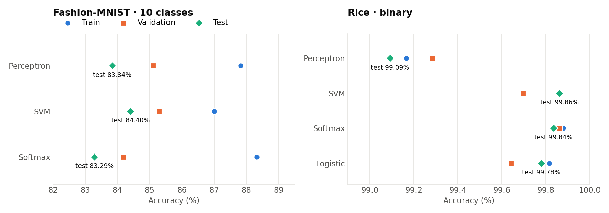

# Linear Classifiers from Scratch

**Four classic linear classifiers (Perceptron, multi-class SVM, Softmax and Logistic Regression) implemented in pure NumPy, with hand-derived gradients and mini-batch SGD, then benchmarked on image classification (Fashion-MNIST) and tabular classification (Rice).**



## The problem

Before deep networks, a linear model `scores = W·x` was the standard way to classify. Every modern network still ends in one: the last layer of a CNN or transformer classifier is exactly a softmax linear classifier. This project builds the four standard variants from first principles, each with its own loss and update rule, and compares them on two very different datasets:

- **Fashion-MNIST:** 28×28 grayscale clothing images, 10 classes. It is hard for a linear model because classes such as shirt, T-shirt and pullover overlap.
- **Rice (Kaggle):** tabular morphological features of rice grains, 2 classes. It is close to linearly separable.

## Results

| Model | Loss / update rule | Fashion-MNIST test acc. | Rice test acc. |
|---|---|---|---|
| Perceptron | mistake-driven update, LR decay ×0.95 per epoch | 83.84% | 99.09% |
| SVM | multi-class hinge loss + L2, mini-batch SGD | **84.40%** | **99.86%** |
| Softmax | cross-entropy + L2, mini-batch SGD | 83.29% | 99.84% |
| Logistic regression | binary cross-entropy (sigmoid), tuned threshold | — (binary only) | 99.78% |

Full train, validation and test numbers are in [`results/accuracy_log.json`](results/accuracy_log.json). The Kaggle submission files are in [`results/kaggle/`](results/kaggle).

**Takeaways**

- **Linear models top out around 84% on Fashion-MNIST.** All three multi-class models land within about 1 point of each other. The limit is the hypothesis class, not the optimizer. Getting past it requires non-linear features, which is what CNNs learn.
- **The hinge loss generalized best.** The SVM had the highest test accuracy on both datasets. Softmax fits the training set best on Fashion-MNIST (88.3%) but shows the largest train-test gap (about 5 points).
- **Rice is close to linearly separable,** so every model exceeds 99% and the differences come down to regularization and tuning.

### Tuned hyperparameters

| Model | Fashion-MNIST | Rice |
|---|---|---|
| Perceptron | lr 0.15 · 15 epochs | lr 0.0005 · 30 epochs |
| SVM | lr 0.005 · 100 epochs · λ = 0.001 | lr 0.0005 · 50 epochs · λ = 0.1 |
| Softmax | lr 0.0005 · 100 epochs · λ = 1 | lr 0.0005 · 50 epochs · λ = 0.0001 |
| Logistic | — | lr 0.5 · 20 epochs · threshold 0.6 |

## Implementation

All models live in `src/models/` and share the same `train` / `predict` interface:

- **Perceptron (`perceptron.py`):** multi-class perceptron. On each mistake it moves the true class's weights toward `x` and the predicted class's weights away. The learning rate decays exponentially.
- **SVM (`svm.py`):** vectorized multi-class hinge-loss gradient with L2 regularization, standardized inputs, mini-batches of 200, shuffling every epoch, and a step learning-rate schedule (halved every 20 epochs).
- **Softmax (`softmax.py`):** numerically stable softmax (max-logit subtraction), cross-entropy gradient `(p − y)ᵀX / N + λW`, mini-batch SGD with learning-rate decay.
- **Logistic regression (`logistic.py`):** numerically stable sigmoid (separate branches for positive and negative inputs), binary cross-entropy gradient, and a tunable decision threshold.

## What I implemented

The course provided the data loaders, the notebook scaffold and the Kaggle submission helper. I implemented the four models (losses, gradients, training loops, learning-rate schedules) and ran the hyperparameter search.

## Repository structure

```
├── src/
│   ├── models/                 # perceptron.py, svm.py, softmax.py, logistic.py
│   ├── data_process.py         # dataset loading and splits (course-provided)
│   └── kaggle_submission.py    # CSV export helper (course-provided)
├── notebooks/linear_classifiers.ipynb   # training and evaluation, with outputs
├── results/                    # accuracy chart, accuracy_log.json, Kaggle CSVs
├── fashion-mnist/get_data.sh   # downloads Fashion-MNIST
├── rice/README.md              # where to get the Rice dataset
├── requirements.txt
└── LICENSE
```

## How to run

```bash
git clone https://github.com/PabloCarreras7/linear-classifiers-from-scratch.git
cd linear-classifiers-from-scratch
pip install -r requirements.txt
(cd fashion-mnist && bash get_data.sh)     # Fashion-MNIST
# Rice: download riceClassification.csv (see rice/README.md) into rice/
jupyter notebook notebooks/linear_classifiers.ipynb
```

Everything runs on a CPU in a few minutes.

## Data

- **Fashion-MNIST:** [zalandoresearch/fashion-mnist](https://github.com/zalandoresearch/fashion-mnist), downloaded by `fashion-mnist/get_data.sh`.
- **Rice Type Classification:** [Kaggle](https://www.kaggle.com/datasets/mssmartypants/rice-type-classification) (`riceClassification.csv`).

## What I learned

- Deriving and vectorizing the gradients of the hinge, cross-entropy and logistic losses, and writing them stably (log-sum-exp style softmax, two-branch sigmoid).
- How much preprocessing and learning-rate schedules matter for plain SGD.
- Where linear models stop working, which motivates the move to learned non-linear features.

## Acknowledgements and transparency

Part of this work comes from **CS 444: Deep Learning for Computer Vision at the University of Illinois Urbana-Champaign (Spring 2026)**. The scaffold and data loaders are by the course staff. I used **Claude Code** as an AI assistant.

## License

[MIT](LICENSE)
